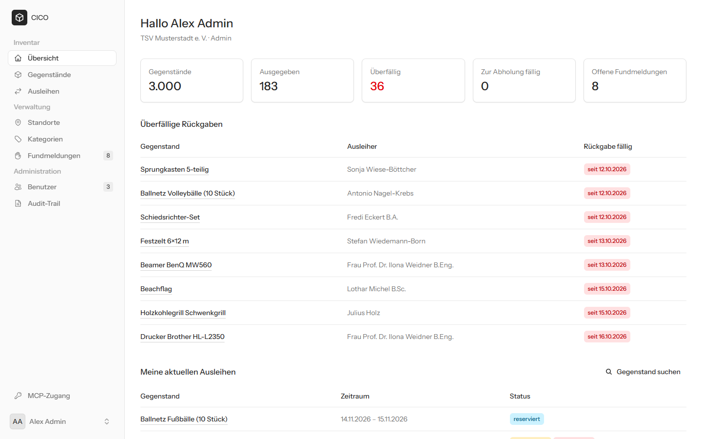
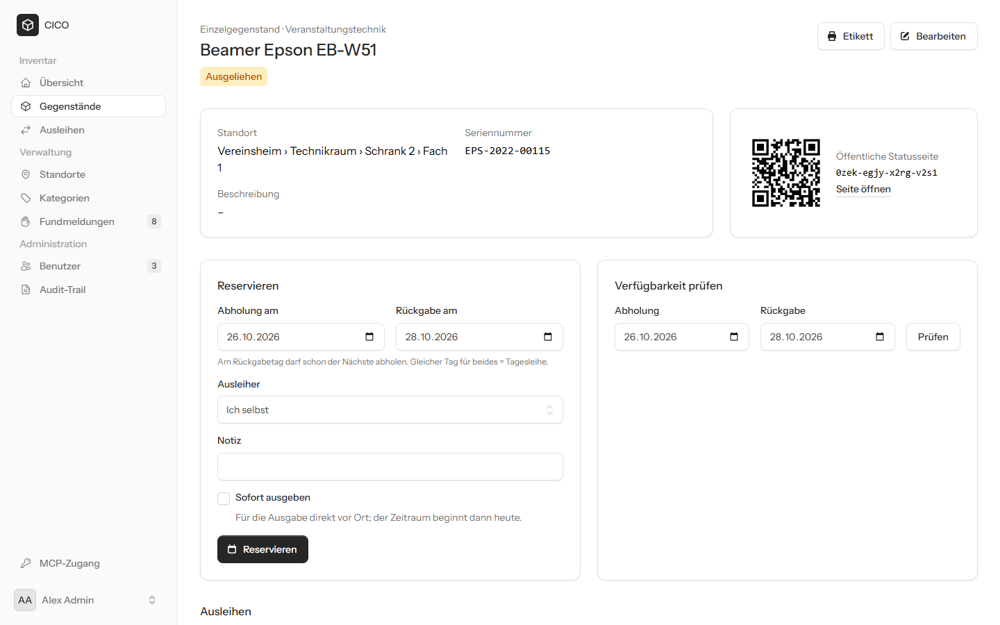
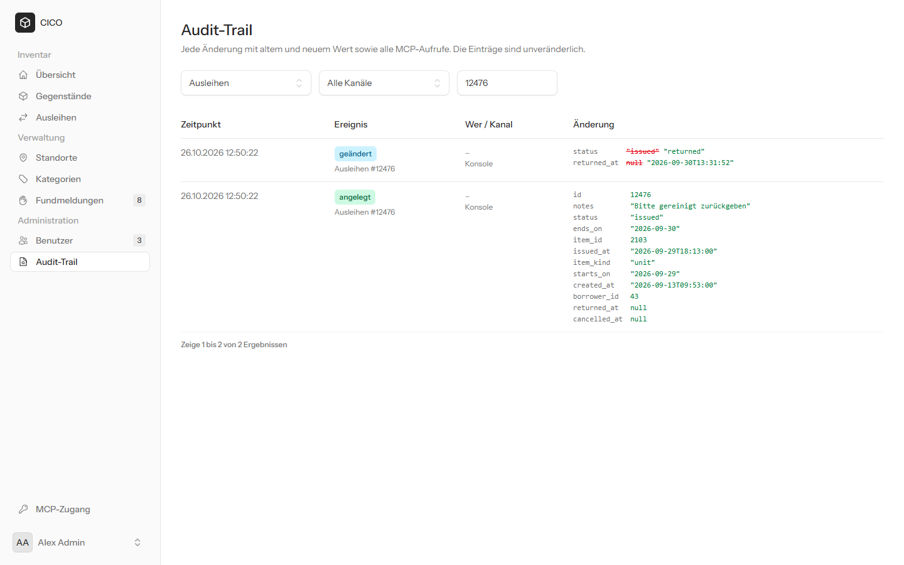
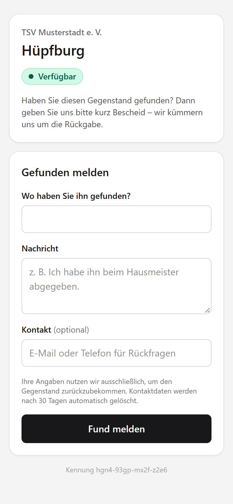

# CICO

CheckIn-CheckOut ist ein Inventar- und Ausleihsystem für Vereine und Organisationen, das Gegenstände, Bestände und Ausleihen revisionssicher verwaltet.

Jeder Gegenstand trägt einen QR-Code, der ohne Login auf eine öffentliche Statusseite führt. Finder können dort ein verlorenes Teil melden. Über einen MCP-Server fragen KI-Assistenten den Bestand ab – mit denselben Rechten und Integritätsregeln wie die Weboberfläche.

**Stack:** Laravel 12 · PHP 8.4 · PostgreSQL 18 · Livewire 4 + Flux · laravel/mcp · Sanctum

| Übersicht für Verwalter | Gegenstand mit QR-Code, Reservierung und Verfügbarkeit |
|---|---|
|  |  |

| Audit-Trail: alter und neuer Wert je Änderung | Öffentliche Statusseite (Handy) |
|---|---|
|  |  |

## Schnellstart

Voraussetzungen: PHP 8.4 (mit `pdo_pgsql`, `intl`, `mbstring`, `zip`), Composer, Node 22+, PostgreSQL 15+.

```bash
composer install
npm install
cp .env.example .env
php artisan key:generate
```

In PostgreSQL eine Rolle und zwei Datenbanken anlegen. Die Rolle muss Eigentümer sein, damit die Migrationen `btree_gist` und `pg_trgm` aktivieren können:

```sql
CREATE ROLE cico LOGIN PASSWORD '…';
CREATE DATABASE cico OWNER cico;
CREATE DATABASE cico_test OWNER cico;
```

Passwort in `.env` eintragen (`DB_PASSWORD`), dann:

```bash
php artisan migrate --seed   # ~3000 Demo-Gegenstände, ein Jahr Ausleihhistorie
npm run build
php artisan serve            # reicht zum Ausprobieren: http://127.0.0.1:8000
```

Für die Entwicklung alles in einem Fenster:

```bash
composer dev       # macOS/Linux: Server, Queue-Worker, Logs (Pail), Vite
composer dev:win   # Windows: Server, Queue-Worker, Scheduler, Vite – Pail braucht pcntl und läuft unter Windows nicht
```

Demo-Zugänge (Passwort jeweils `password`):

| E-Mail | Rolle |
|---|---|
| `admin@cico.test` | Admin |
| `verwalter@cico.test` | Verwalter |
| `ausleiher@cico.test` | Ausleiher |

Neue Registrierungen warten auf Freischaltung: Bis ein Admin ihnen unter **Benutzer** eine Rolle gibt, sehen sie keine Inhalte und haben keinen MCP-Zugang. Admins können wartende Konten auch ablehnen. Der Demo-Seeder legt drei solcher Konten an.

Die Löschfrist für Finder-Kontaktdaten läuft über den Scheduler (`php artisan schedule:work` lokal, in `composer dev:win` enthalten; im Betrieb per Cron bzw. Windows-Aufgabenplanung `schedule:run`).

## MCP-Zugang

1. In der Weboberfläche unter **MCP-Zugang** ein persönliches Token erzeugen.
2. Client mit `http://<host>/mcp` und dem Header `Authorization: Bearer <token>` verbinden, z. B. in Claude Code:

   ```bash
   claude mcp add --transport http cico http://127.0.0.1:8000/mcp --header "Authorization: Bearer <token>"
   ```

Tools (alle read-only):

| Tool | Zweck |
|---|---|
| `search-items` | Bestand nach Name, Seriennummer oder Kennung durchsuchen; Filter nach Art, Kategorie, Standort (inkl. Unterstandorten), Zustand |
| `check-availability` | Ist ein Einzelgegenstand im Zeitraum frei? Namen anderer Ausleiher nur für Verwalter |
| `list-my-loans` | Eigene Ausleihen und Reservierungen, „überfällig“ abgeleitet |

## Architektur

Die Geschäftslogik liegt in `app/Actions` (schreibend) und `app/Queries` (lesend). Livewire-Seiten, der öffentliche Controller und die MCP-Tools sind dünne Adapter. Rechteprüfung (Policies), Validierung und die Übersetzung von Datenbankfehlern in verständliche Meldungen passieren in der Action, also für Web und MCP identisch.

Die Datenbank ist die letzte Instanz für Integrität (R36):

| Regel | Umsetzung |
|---|---|
| Einzelgegenstand ↔ Seriennummer, Mengenware ↔ Menge (R1) | `CHECK items_kind_fields`, eindeutige Seriennummern per Partial Index |
| Standortbaum ohne Zyklen (R2) | Trigger `locations_prevent_cycle` mit Advisory Lock gegen parallele Umhängungen |
| Keine überlappenden Ausleihen (R6) | `EXCLUDE USING gist (item_id WITH =, period WITH &&) WHERE status IN ('reserved','issued')` auf `period = [Abholtag, max(Rückgabetag, Abholtag + 1))` – am Rückgabetag darf der Nächste abholen, eine Tagesleihe belegt genau ihren Tag |
| Nur einmal gleichzeitig ausgegeben | Partial Unique Index `loans_one_issued_per_item` (greift auch bei überfälligen Rückgaben) |
| Gültige Statuswechsel, abgeschlossene Ausleihen unveränderlich, kein Löschen | Trigger `loans_guard` |
| Mengenware im MVP nicht ausleihbar | Fremdschlüssel auf `items(id, kind)` + `CHECK loans_unit_items_only` |
| Nicht erratbare öffentliche Kennung (R11) | 80 Bit Crockford-Base32, `CHECK items_public_id_format` |
| Audit-Trail mit altem/neuem Wert (R18) | Generischer Trigger `cico_audit()` auf allen Fachtabellen; `audit_logs` per Trigger unveränderlich |

Wer eine Änderung auslöst, reicht `App\Support\AuditContext` als PostgreSQL-Session-Variablen (`cico.user_id`, `cico.channel`, `cico.client`) an die Trigger weiter. Dadurch landen auch Änderungen per Konsole oder direktem SQL im Audit-Trail. Passwörter, Tokens und Finder-Kontakte werden dort geschwärzt.

## Umsetzungsstand

Umgesetzt ist der vollständige MVP aus dem Anforderungsdokument: R1, R2, R5, R6, R11–R14, R18, R21–R23, R25–R28, R33, R35–R39.

Bewusste Entscheidungen und Abweichungen:

- **Laravel 12 statt 13:** Laravel 12 ist die bevorzugte Version für den Einsatzkontext. Alle Pakete sind 13-kompatibel, ein Upgrade ist möglich.
- **Status „storniert“:** Ergänzt zu reserviert/ausgegeben/zurück. Ohne ihn blieben nicht abgeholte Reservierungen dauerhaft blockierend, und Löschen widerspräche der Revisionssicherheit.
- **Stichtag-Tool (R28):** Fehlt bewusst, laut Dokument erst mit R19.
- **R26:** Persönliche Tokens per Sanctum. OAuth 2.1 über Passport ist als Ausbau möglich.
- **R16 teilweise vorgezogen:** Das Fundformular ist bereits auf 5 Meldungen pro Minute begrenzt.
- **Benachrichtigungen (R14):**
  - Verwalter und Admins tragen sich unter *Einstellungen › Benachrichtigungen* für Fundmeldungen ein. Ist niemand eingetragen, geht die Mail an alle Verwalter und Admins, damit R14 erfüllt bleibt.
  - Die Mail enthält keine Finder-Kontaktdaten, damit diese nach Ablauf der Frist nicht in Postfächern weiterleben.
  - Für neue Registrierungen können sich nur Admins eintragen, hier gibt es keine Rückfallebene.
- **Freischaltung:** Neue Konten bekommen die Rolle „wartet auf Freischaltung“. Das Dokument regelt die Registrierung nicht. Ohne Freischaltung sähe jeder Fremde den Katalog samt Lagerorten.
- **R33:** Protokolliert jeden MCP-Aufruf außer `ping`.
- **Kontolöschung:** Konten mit Ausleihhistorie bleiben erhalten (Revisionssicherheit), der letzte Admin kann sich nicht löschen oder herabstufen.

## Tests

```bash
php artisan test
```

Die Tests laufen gegen die PostgreSQL-Datenbank `cico_test`, weil die Integritätsregeln in der Datenbank leben. Sie decken unter anderem ab:

- jede Constraint- und Triggerregel,
- parallele Buchungen über zwei echte Datenbankverbindungen,
- die öffentliche Seite (keine personenbezogenen Daten, Fundmeldung, Löschfrist, Rate-Limit),
- jedes MCP-Tool über den echten HTTP-Endpunkt mit Token, inklusive Rechteverletzungen,
- Audit-Trail und Seeder.

---

Entwickelt mit Unterstützung von [Claude Code](https://claude.com/claude-code).
